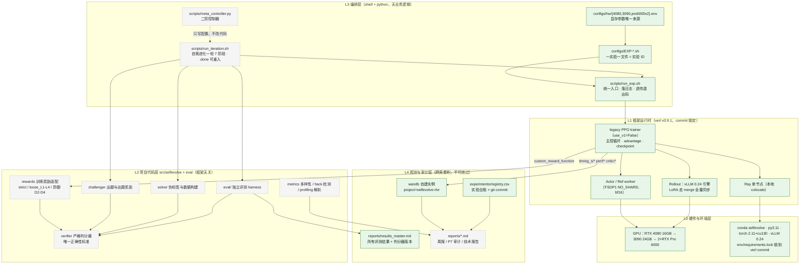
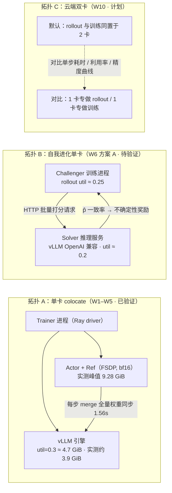
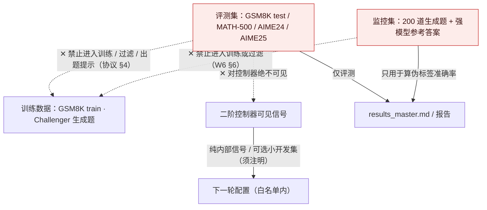

# 系统架构设计

> 本文回答「**这个系统由哪些层组成、每层为什么这样切**」。
> 模块职责与接口见 [`docs/modules.md`](modules.md)；运行时的数据流与流程见 [`docs/pipeline.md`](pipeline.md)。
>
> 状态标注贯穿本项目全部文档：**[已实现]** = 代码已提交且跑过；**[设计]** = 接口已定但未实现；**[计划]** = 按周计划待开工。
> 最后更新：2026-10-20（W1 收工）。

## 1. 设计目标与约束

架构不是为了「好看」，而是为了同时满足三个互相拉扯的目标（`01_VISION.md`）：**可复现、可审计、跑得快**。

| 约束 | 来源 | 对架构的直接影响 |
|---|---|---|
| 单张消费级 GPU（16GB → 24GB → 云端 2×96GB） | 愿景 / 00_README | 显存参数必须外置成硬件档位；训练与推理进程共卡，预算要显式切分 |
| 不得中途升级核心依赖 | 协议 §2 | verl 按 commit 锁定并作为 `third_party/` 源码树存在，不是 pip 包的浮动版本 |
| 测试集只能用于评测 | 协议 §4（红线） | 评测 harness 与训练框架解耦；出题、过滤、伪标签三条路径都不得接触评测集 |
| 训练奖励与评测必须共用同一 verifier | 协议 §4 | verifier 是独立模块，**不依赖 verl**，由 rewards 适配层接入训练 |
| 每个数字可追溯 | 愿景（诚信原则） | 观测层与实验登记是架构的一部分，不是附属脚本 |
| 要能回答「瓶颈在哪」 | RQ3 | 分阶段计时必须是一等公民，优化前后都用同一套 key 对比 |

## 2. 分层架构

实线框 = W1 已跑通；虚线框 = 待建（交付周见 [`docs/modules.md`](modules.md)）。

### 2.1 每层的职责边界（以及**不该**做什么）

| 层 | 职责 | 明确不做 | 状态 |
|---|---|---|---|
| L0 硬件与环境 | 固定算力与依赖版本 | 不随手升级；不在 `/` 根盘写缓存 | [已实现] |
| L1 框架运行时 | RL 训练循环、分布式、推理引擎 | **不写项目业务逻辑**；`third_party/verl` 原则上零修改 | [已实现] |
| L2 项目代码 | 判分、奖励、出题、伪标签、指标、评测 | 不依赖 verl 的类型（除 rewards 的薄适配层）；不读测试集 | [计划 W3–W8] |
| L3 编排 | 阶段顺序、重入、参数注入、日志 | 不藏超参（全部来自 configs/hw）；不做算法决策 | [部分实现] |
| L4 观测与审计 | 指标、台账、结果汇总、报告 | 不做结果筛选；失败的实验同样入档 | [已实现骨架] |

**L1 与 L2 的切分是本架构最重要的一条线。** verl 迭代很快（W1 就撞上两个上游 bug），把判分、奖励、出题逻辑写进框架里会让项目被框架版本绑死，更关键的是 —— 判分器是 P7 审计的对照基准，它必须能在没有 GPU、没有 verl 的环境里被单测反复拷打。

## 3. 进程与显存拓扑

显存是本项目的第一约束，所以「谁在哪个进程、占多少显存」属于架构决策，而不是调参细节。

- **拓扑 A 的两个硬事实（W1 实测）**：actor 侧必须显式 `model_dtype=bf16`（FSDP 默认 fp32 会让 1.5B 参数吃掉 6.2GB 并在权重恢复时 OOM）；vLLM 必须显式 `max_model_len`，否则按模型上限 32768 预留 KV cache 直接起不来。细节见 `docs/troubleshooting.md` §3.3 / §3.8。
- **拓扑 B 是 W6 最吃显存的环节**：Challenger 的奖励计算需要 Solver 推理，两个角色同时在卡上。方案 A 不可行时退到方案 B（分阶段离线执行），代价是偏离在线 RL，必须在设计文档里写明取舍。
- **拓扑 C 的对比本身就是交付物**（`reports/system_comparison.md`），不是选型过程。

## 4. 关键架构决策（ADR 摘要）

每条都附「为什么」和「什么时候复审」—— 没有复审时机的决策会变成技术债。

| # | 决策 | 理由 | 证据 | 复审时机 |
|---|---|---|---|---|
| A1 | verl 以**源码 + commit** 形式进 `third_party/`，并写进 `requirements.lock` | 上游迭代快，必须能逐行核对源码；pip 浮动版本无法审计 | `env/requirements.lock:243` 锁 `@1876b06d` | 升级时（需请示） |
| A2 | 走 **legacy trainer**（`use_v1=False`） | v1 的 `_compute_advantage` 硬读 `values`，critic-free GRPO 必崩；且 verl 官方文档要求 `use_v1=false` 才能开 full determinism | `trainer_base.py:1760`；`docs/advance/determinism.md:82` | W9/W10 建新环境时 |
| A3 | LoRA 权重同步走 **merge 全量**，不走 adapter 增量 | vLLM 0.24 的 `add_lora` 与 verl adapter 路径不兼容；merge 是官方同样支持的路径 | `docs/troubleshooting.md` §3.5；代价实测 1.56s/步 ≈ 6.7% | W9（吞吐周） |
| A4 | 显存参数集中在 `configs/hw/*.env`，**换卡只改 `HW`** | 同一结论要在 4080/3090/云端三种卡上复现；参数散落必然漂移 | `tests/test_skeleton.py` 机械校验两档变量名一致 | 每次新增硬件档位 |
| A5 | **评测 harness 独立于训练框架**（`eval/`，vLLM 离线推理） | 训练框架内的验证循环口径会随版本变；所有对外结论必须出自同一套评测代码 | 协议 §4；W2 任务 2 | — |
| A6 | **verifier 是唯一正确性标准**，训练奖励与评测共用 | 否则「奖励涨了」和「真的会做题了」无法区分 —— 这正是 P7 的核心命题 | 协议 §4；W3 → W5 冻结为 `verifier-v1.0` | 改动需重评受影响结果 |
| A7 | 宽松判分器（L1–L4）与防御（D2–D5）都做成**可开关配置**，与严格 verifier 并存 | hacking 实验要的是「同一管线只换判分器」的对照，不是另一套代码 | W4 / W5 | — |
| A8 | 二阶控制器**只能输出配置**，白名单在代码层强制 | 允许它改代码会让所有结论失去可控性 | W11b 硬约束 | — |

## 5. 信任边界

架构里有四道边界，越过任何一道都会让结论作废。它们必须由代码或流程强制，不能只靠自觉：

1. **测试集隔离**：13-gram 重叠检查是 W7 的验收项，命中的生成题必须从训练集剔除。
2. **监控集只读**：参考答案由更强模型投票得到，只用于度量伪标签准确率，不进训练、不进过滤。
3. **verifier 冻结**：W5 决策门通过后打 tag `verifier-v1.0`，此后任何改动单独 commit + registry 注明 + 重评。
4. **控制器白名单**：不得改 verifier、评测代码、数据与种子策略；越界自动回退并记录。

## 6. 可复现性契约

| 维度 | 机制 | 状态 |
|---|---|---|
| 环境 | `env/versions.md` + `requirements.lock`（verl 锁到 commit） | [已实现] |
| 配置 | 一实验一 `configs/EXP-*.sh`，运行前 commit，hash 入 registry | [已实现] |
| 随机性 | 默认 seed=42；统计结论 ≥2 种子（42/1234），云端主结果尽量 3 个；`use_v1=False` 是 full determinism 的前提 | [已实现约定] |
| 中断恢复 | verl checkpoint + `resume_mode=auto`；自我进化靠阶段 `.done` 标记 | [已验证 / 设计] |
| 结果溯源 | 每行结果标注 GPU + 判分器版本 + wandb run | [已实现] |
| 端到端复现 | W12 在全新环境 clone → 装环境 → 冒烟 → 评测，误差落在报告方差内 | [计划 W12] |

## 7. 已知架构风险

| 风险 | 影响 | 现在的处置 |
|---|---|---|
| 绑在 legacy trainer 上，拿不到 v1 的 async/partial rollout | 只影响 W10 的多卡吞吐方案选择 | W10 本就重建环境，届时独立评估；本地环境保持冻结 |
| merge 同步每步传全量权重 | 单步 ~6.7% 开销，模型变大后占比上升 | W9 重新评估 adapter 路径或升级 |
| 无 flash-attn（actor/ref 走 SDPA） | 训练前向偏慢、显存偏高 | W9 评估是否值得编译；rollout 侧不受影响 |
| 0.6B/1.7B 规模的自我进化增益可能被噪声淹没 | 结论只能算概念验证 | 多种子 + 对照组 + 如实标注规模 |
| 云端实例被回收 | 丢进度与钱 | `save_freq` 调小、checkpoint 上持久存储、实测一次续跑 |

## 8. 关联文档

- `01_VISION.md` —— 研究问题、成功标准、与 RSI 的关系
- `02_AGENT_PROTOCOL.md` —— 仓库结构、实验管理、红线
- [`docs/modules.md`](modules.md) —— 模块职责、接口契约、依赖规则
- [`docs/pipeline.md`](pipeline.md) —— 单步训练、单轮迭代、评测与实验生命周期流程
- `docs/troubleshooting.md` —— 与上游的差异、所有故障的现象/原因/解法
- `reports/week01_summary.md` —— 本文中 W1 实测数字的来源
