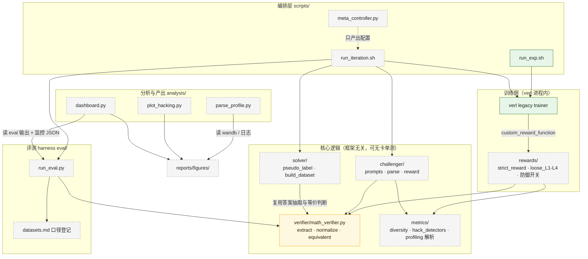

# 模块设计

> 本文回答「**代码分成哪些模块、各自的接口是什么、谁能依赖谁**」。
> 分层与架构决策见 [`docs/architecture.md`](architecture.md)；运行时流程见 [`docs/pipeline.md`](pipeline.md)。
>
> 状态：**[已实现]** / **[设计]** / **[计划]**。最后更新：2026-10-20（W1 收工，L2 只有包骨架）。

## 1. 模块依赖图

箭头方向 = 依赖方向（A → B 读作「A 依赖 B」）。



图里只有一个黄色节点：**`verifier` 是所有正确性判断的汇聚点**。rewards、solver 的投票、eval harness 三条路径都指向它，这是协议 §4「训练奖励与评测必须共用同一严格 verifier」在代码结构上的体现。

## 2. 依赖规则（硬规则，评审时按此检查）

1. **`verifier` 不依赖任何其他项目模块，也不依赖 verl / vLLM。** 它只吃字符串，吐结构化结果，因此能在没有 GPU 的机器上跑 80+ 用例。
2. **只有 `rewards` 可以感知 verl 的接口形状**，并且只在函数签名这一层（`compute_score(...)`）。verl 的类型不得渗进 `verifier` / `challenger` / `solver`。
3. **`solver/pseudo_label.py` 必须复用 `verifier` 的抽取与等价判断**，不得自己再写一套 —— 否则投票口径和评测口径会悄悄分叉，而这种分叉在结果里表现为「伪标签准确率虚高」。
4. **`analysis/` 只读**：读 wandb、读日志、读评测输出，产出 `reports/figures/`，不参与训练与打分。
5. **`metrics/` 不改变任何判定**：它度量现象（长度、重复、数字个数、簇熵），不决定 reward；reward 的归属永远在 `rewards/`。
6. **编排层不藏超参**：所有可调量来自 `configs/`，显存相关量来自 `configs/hw/*.env`。

## 3. 模块清单

| 路径 | 职责 | 交付周 | 单测要求 | 状态 |
|---|---|---|---|---|
| `src/selfevolve/verifier/math_verifier.py` | 严格答案判分：抽取 → 归一化 → 等价判断 → 结构化结果 | W3 | ≥80 用例（等价形式 / 对抗 / 边界） | [计划] |
| `src/selfevolve/rewards/strict_reward.py` | 把 verifier 适配成 verl 自定义奖励 | W3 | 签名与返回值 | [计划] |
| `src/selfevolve/rewards/loose_*.py` | L1 格式权重过高 / L2 子串匹配 / L3 取首个数字 / L4 长度奖励 | W4 | 每种 3–5 个用例，**证明漏洞按设计存在** | [计划] |
| `src/selfevolve/rewards/defenses.py` | D2 答案唯一性 / D3 超长惩罚 / D4 双解析器一致（D1=严格 verifier，D5=KL 系数属配置） | W5 | 每项防御的触发与不触发用例 | [计划] |
| `src/selfevolve/metrics/hack_detectors.py` | reward gap、数字个数、boxed 个数、长度 p95、截断率、首数字位置、重复 n-gram | W4 | 逐指标用例 | [计划] |
| `src/selfevolve/metrics/diversity.py` | BLEU 重复率、embedding 聚类簇熵 | W6 | 退化样本（全同题）应给出极低多样性 | [计划] |
| `src/selfevolve/metrics/profiling.py` | 解析 `timing_s/*` / `perf/*`，出表与饼图数据 | W2 | 解析器用例 | [计划] |
| `src/selfevolve/challenger/prompts.py` | 出题 prompt（Base 模型不遵循 chat 格式，参考 R-Zero 写法） | W6 | prompt 版本化 | [计划] |
| `src/selfevolve/challenger/parse.py` | 解析生成题 + 合法性检查：长度、题干完整、**是否偷带答案** | W6 | 非法样本全覆盖 | [计划] |
| `src/selfevolve/challenger/reward.py` | 不确定性奖励 `1-2·\|p̂-0.5\|` − 重复惩罚，非法题记 0 | W6 | 数值边界 + 惩罚聚类 | [计划] |
| `src/selfevolve/solver/pseudo_label.py` | 批量采样 m 次 → 等价合并计票 → 伪标签 + 一致率 p̂ | W6 | 等价答案必须合并计票 | [计划] |
| `src/selfevolve/solver/build_dataset.py` | 难度带过滤 + 去重 + 合法性 → verl 格式 parquet | W6 | 过滤边界、schema 正确 | [计划] |
| `eval/run_eval.py` | 独立评测：vLLM 离线推理 → 逐样本 JSONL + 汇总 JSON | W2 | 小样本端到端 | [计划] |
| `eval/datasets.md` | 数据集与指标口径登记（名称、题数、采样参数） | W2 | — | [计划] |
| `analysis/parse_profile.py` / `plot_hacking.py` / `dashboard.py` | profiling 表与饼图 / hacking 双曲线图 / 迭代面板 | W2 / W4 / W8 | — | [计划] |
| `scripts/run_exp.sh` | 统一实验入口：落日志、透传退出码、设 `RAY_TMPDIR` 等 | W1 | — | [已实现] |
| `scripts/prepare_data.sh` | GSM8K 预处理 + 模型下载，`.done` 可重入 | W1 | — | [已实现] |
| `scripts/run_iteration.sh` | 自我进化 7 阶段编排，阶段级 `.done` | W7 | — | [计划] |
| `scripts/meta_controller.py` | 读监控 → 调 LLM → 白名单校验 → 写下一轮配置 | W11b | 白名单校验与回退逻辑 | [计划] |
| `tests/test_skeleton.py` | 骨架机械校验：协议目录、子包可导入、两档硬件变量名一致、registry 表头 | W1 | 19 项，`pytest -q` 全绿 | [已实现] |

## 4. 核心接口契约

接口先定、实现后补 —— 下面的签名是各周开工时的契约，改动要在周报里写明。

### 4.1 verifier（W3，全项目的地基）

```python
@dataclass
class VerifyResult:
    score: float            # 1.0 正确 / 0.0 其它；格式奖励默认 0 且不启用
    extracted: str | None   # 抽取到的最终答案
    parse_ok: bool
    reason: str             # correct | wrong | no_answer | multiple_answers | truncated | timeout

def verify(response: str, ground_truth: str, *,
           finished: bool | None = None,
           timeout_s: float | None = None) -> VerifyResult: ...
```

设计原则（W3）：**只奖励正确性；宁严勿松；确定性 + 超时保护**。抽取优先级：最后一个 `\boxed{}`（处理嵌套）→ GSM8K 的 `#### 答案` → 结尾的 "The answer is ..." → 结尾结论句（第四级，见下）。多候选、推理中途出现正确数字、截断 —— 一律判错。

**W3 实际实现与 W1 契约的差异（改动已记入周报）**：

1. **没有 `data_source` 参数**。verifier 只做数学答案判定；选择题（MMLU-Pro）的字母判定留在适配层
   （`eval/harness/scoring.py::score_mc`、`src/selfevolve/rewards/strict_reward.py`），
   因为选择题根本不需要 `parse/verify` 这套等价判断，塞进来只会让"唯一标准"多一条不走同一路径的分支。
2. **多了 `finished`**。评测侧能从 `finish_reason` 知道输出是否被 `max_tokens` 截断；训练侧拿不到，
   传 `None` 走文本推断（未闭合的 `\boxed{` / 尾部未闭合的 `\[` / 尾部无句末标点的长文本）。
3. **多了第四级抽取"结尾结论句"**。只用前三级时，Qwen2.5-1.5B-Instruct 有 45% 的 GSM8K 输出
   抽不到答案（它不写 `####`），base GSM8K 会从 0.72 掉到 0.38 —— 那是"格式不合规"不是"能力不行"。
   追加的规则很保守：必须是最后一句、必须有结论引导词或是短句、句内只有一个可判定的值，
   且**有 marker 时不参与**。影响量化见 `reports/verifier_validation.md §7`。
4. `VerifyResult` 不是 `frozen=True`（构造后不再被修改，但没有必要冻结）；字段与理由保持契约不变。

### 4.2 rewards（W3/W4/W5，唯一与 verl 耦合的地方）

```python
def compute_score(data_source: str, solution_str: str, ground_truth: str,
                  extra_info: dict | None = None, **kwargs) -> float | dict: ...
```

通过 **`reward.custom_reward_function.path` / `.name`** 接入（verl v0.9.1 的实际键名；
W1 写作顶层 `custom_reward_function.*`，见 `docs/troubleshooting.md §5.1`）。宽松版 `loose_L*` 与
防御 `D*` 共用同一签名，**只换判分口径，不换管线** —— 这是 W4/W5 对照实验成立的前提。
若奖励计算超过单步耗时 5%，改多进程或用框架自带的并行 reward manager（本版本自带
`reward.num_workers=8`；W3 实测 reward ≈ 0.04 s/step，不需要额外并行）。

### 4.3 solver / challenger（W6）

```python
@dataclass
class PseudoLabel:
    question_id: str
    label: str          # 多数票答案（等价答案已合并）
    agreement: float    # p̂ ∈ [0,1]
    votes: dict[str, int]

def vote(samples: list[str], *, data_source: str) -> PseudoLabel: ...

def challenger_reward(batch: list[Question], agreements: list[float],
                      *, rep_weight: float) -> list[float]:
    """max(0, (1 - 2*|p̂ - 0.5|) - 重复惩罚)；非法题直接 0。"""
```

`vote` 必须调用 verifier 的等价判断来合并计票（规则 3）；`build_dataset` 只保留 p̂ 落在难度带内的题（初值 [0.3, 0.7]），伪标签当 ground truth，奖励仍由严格 verifier 给。

### 4.4 评测 harness（W2）

```python
# eval/run_eval.py
#   输入：模型路径（基座或合并后的 LoRA）、数据集列表、采样配置、prompt 模板（显式传入）
#   输出：results/<run>/samples.jsonl  每行 {id, output, extracted, correct, reason}
#         results/<run>/summary.json   {dataset: {metric, value, n, sampling, verifier_version}}
```

口径固定：GSM8K / MATH-500 用 pass@1（greedy, temperature=0）；AIME 用 avg@16（temperature=0.6, top_p=0.95）并报告标准差。prompt 模板必须与训练一致。W2 先用 Math-Verify 封装，W3 换成严格 verifier 并回归重评。

### 4.5 二阶控制器（W11b，可选）

```python
def propose_next_config(monitor: dict, history: list[dict]) -> tuple[dict, str]:
    """返回 (下一轮配置, 决策理由)。越界或非法 → 回退上一轮配置并记录。"""
```

白名单（难度带上下限、m、重复惩罚权重、训练步数上限、题目池上限）在**代码层**强制，不靠提示词。每次决策追加到 `experiments/meta_decisions.jsonl`，含输入摘要、输出、理由、token 花费。

## 5. 测试矩阵

协议 §8：判分、奖励、过滤等核心逻辑必须有 pytest 单测，`pytest -q` 全绿后才能用于训练。

| 测试文件 | 覆盖 | 周 | 状态 |
|---|---|---|---|
| `tests/test_skeleton.py` | 目录骨架、子包导入、硬件档位变量名一致、registry 表头 | W1 | [已实现] 19 passed |
| `tests/test_math_verifier.py` | ≥80 用例：等价形式 / 对抗样本 / 边界 | W3 | [计划] |
| `tests/test_loose_rewards.py` | L1–L4 的漏洞「按设计存在」 | W4 | [计划] |
| `tests/test_defenses.py` | D2–D4 的触发与误伤 | W5 | [计划] |
| `tests/test_pseudo_label.py` | 等价答案合并计票、p̂ 计算、空样本 | W6 | [计划] |
| `tests/test_challenger_parse.py` | 非法题识别（偷带答案、截断、超长） | W6 | [计划] |
| `tests/test_build_dataset.py` | 难度带边界、去重、parquet schema | W6 | [计划] |
| `tests/test_meta_whitelist.py` | 白名单越界与回退 | W11b | [计划] |

## 6. 冻结与变更流程

| 对象 | 冻结时机 | 变更要求 |
|---|---|---|
| `verifier` | W5 决策门通过后打 tag `verifier-v1.0` | 单独 commit + registry 注明 + **重评所有受影响结果** + results_master 标注新版本 |
| prompt 模板 | 进入正式迭代即版本化（`configs/meta/prompt_v1.md` 同理） | 新版本新文件，不原地改 |
| 硬件档位 | 实测后回写 | 只改 `configs/hw/*.env`；两档变量名必须保持一致（有单测兜着） |
| 核心依赖 | W1 锁定 | 协议 §2：中途不升级；确需升级先请示，升级后重跑 baseline 冒烟 |

## 7. 关联文档

- [`docs/architecture.md`](architecture.md) —— 分层、拓扑、ADR、信任边界
- [`docs/pipeline.md`](pipeline.md) —— 这些模块在运行时如何被串起来
- `docs/data_format.md` —— GSM8K parquet 的字段契约（`build_dataset` 的输出目标格式）
- `docs/metrics_keys.md` —— 训练指标 key 名（`metrics/profiling.py` 的输入）
