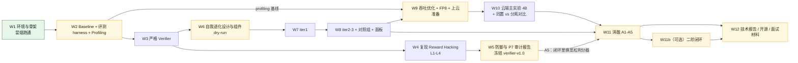
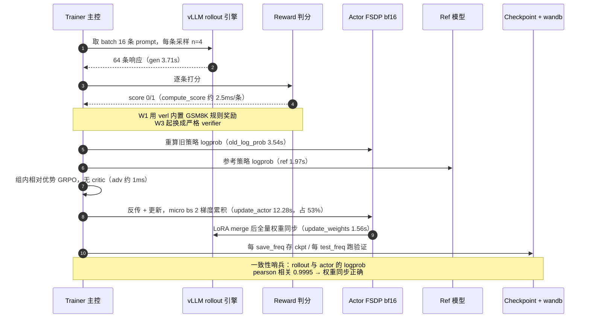
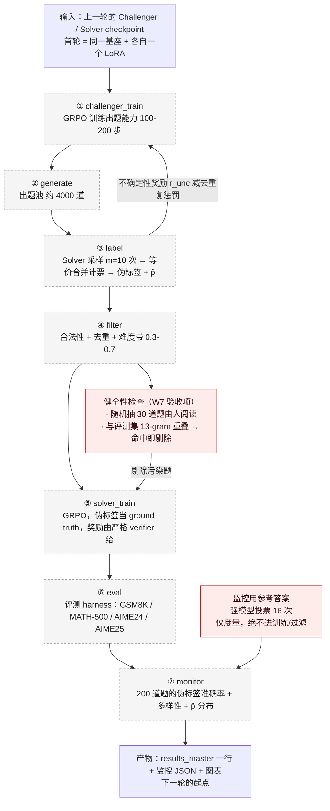
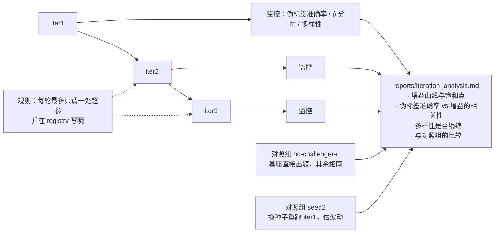
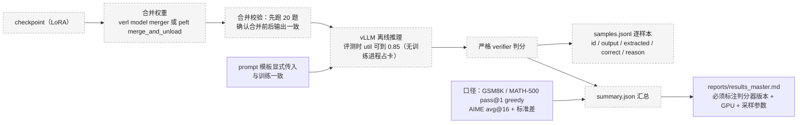
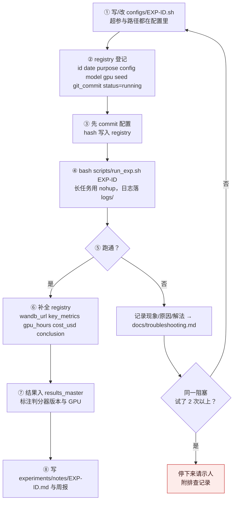
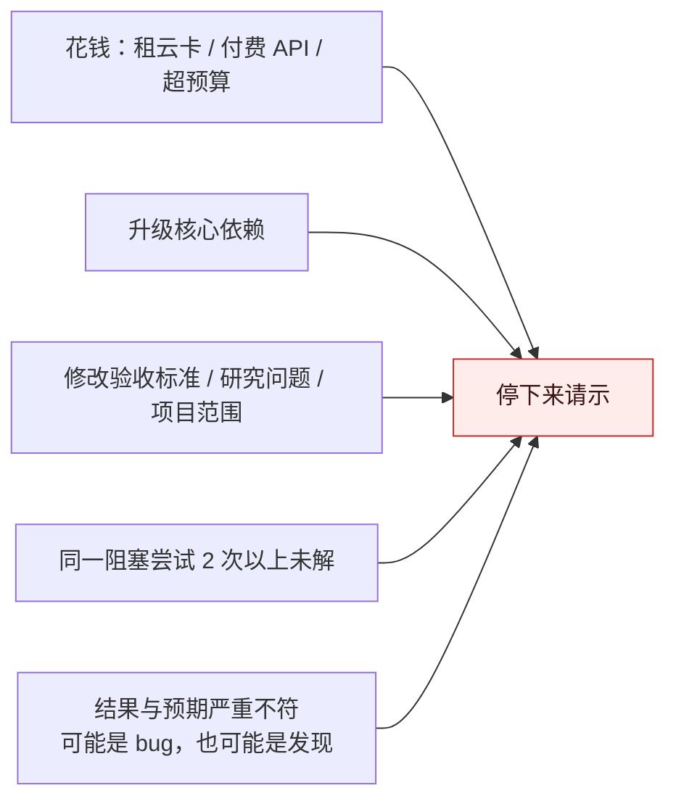
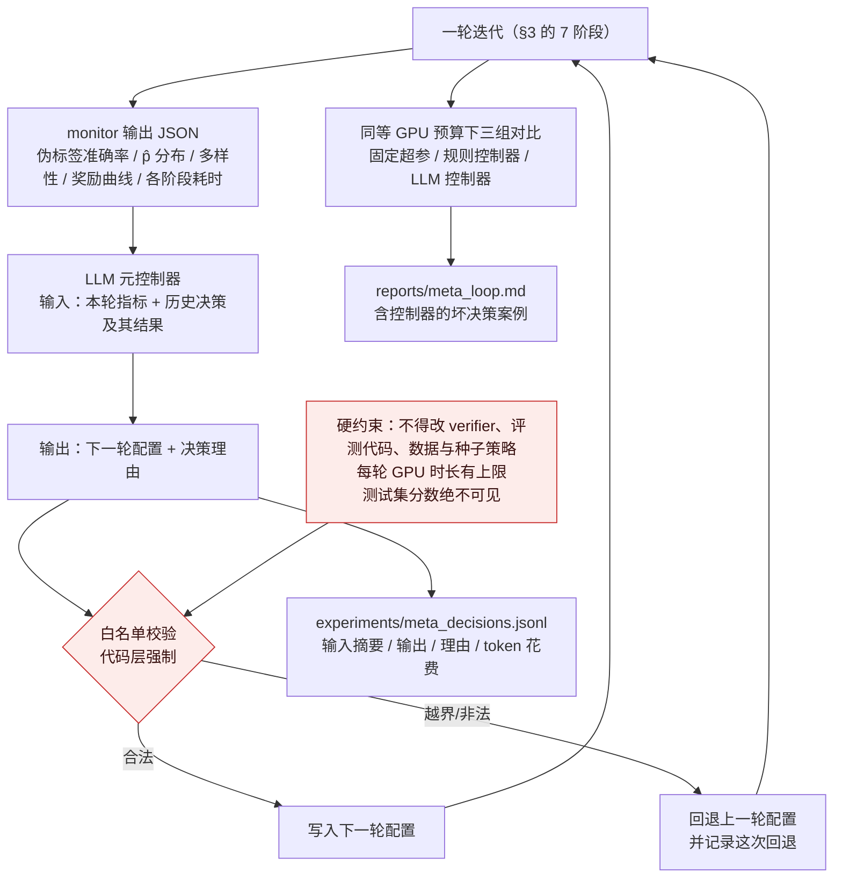

# 流程设计

> 本文回答「**东西是怎么跑起来的**」：训练单步、自我进化单轮、多轮回路、评测、实验生命周期、二阶闭环。
> 分层见 [`docs/architecture.md`](architecture.md)；模块与接口见 [`docs/modules.md`](modules.md)。
>
> 状态：**[已实现]** / **[设计]** / **[计划]**。最后更新：2026-10-20（W1 收工）。

## 1. 项目总流程：三条主线

12 周不是线性推进，而是三条主线交汇。看懂这张图就知道每周的产物被谁消费。

黄色 = 带人工决策门（`00_README.md` 总览表）。**W3 是两条主线的共同地基**：P7 审计用它当对照基准，P1 自我进化用它当闭环奖励。W5 的 A5 消融把两条线接回一起 —— 闭环对判分器质量有多敏感，是全项目的亮点之一。

## 2. GRPO 单步训练流程 [已实现]

下图是 W1 实测跑通的链路，括号里是 4080 上的实测耗时（单步均值 23.2s，来源 `docs/metrics_keys.md` §4）。

**两个要点**：

- **瓶颈在训练侧，不在 rollout**：`update_actor` 占 53%，`gen` 只占 16%。W9 的优化顺序由此决定（micro-batch / 打包 / kernel 优先于 rollout 并发）。
- **`training/rollout_actor_probs_pearson_corr` 是权重同步的哨兵**：它掉下来就说明 rollout 用的策略和训练的策略脱钩了。W9 做 FP8 rollout 时，这个指标和 log-prob 差异是判断「轻度 off-policy 是否可接受」的主要依据。

## 3. 自我进化单轮迭代流程 [设计 W6 / 实现 W7]

`scripts/run_iteration.sh` 的 7 个阶段。每个阶段完成后写 `.done`，重跑时跳过 —— 这是协议 §8 的可重入要求，也是云端被回收后能接着跑的前提。

**阶段 ③ 是整条流程的脖子**：它既产出 Solver 的训练标签，又产出 Challenger 的奖励信号（p̂）。所以

- 它的显存拓扑最紧（见架构文档拓扑 B：Challenger 训练进程 + Solver 推理服务同卡）；
- 它的耗时可能超过训练本身（W7 常见坑），W9 会专门优化批量请求大小与并发；
- 它的口径必须与评测一致（投票复用 verifier 的等价判断），否则伪标签准确率会虚高。

**每个阶段都要记墙钟时间和 GPU 时长** —— 这是 W9 优化自我进化流程的唯一依据。

## 4. 多轮迭代与饱和判定 [计划 W8]

RQ2 的问题不是「能不能涨」，而是「**涨到第几轮停、为什么停**」。

两条判读纪律：

1. **轮次间波动可能小于换种子的波动** —— 没有 seed2 数据时，不对小于 1 分的差异下结论。
2. **饱和不等于失败**，但必须给出机制解释：伪标签噪声累积？多样性塌缩（Challenger 退化成反复出相似题）？还是 Solver 已经吃干了这个难度带？

## 5. 评测流程 [计划 W2]

所有对外数字都走这一条路，训练框架内的验证分数只作参考。

- **框架内分数与 harness 分数不一致是预期现象**（W2 常见坑）：以 harness 为准，但必须解释差异来源。
- **AIME 只有 30 题**，必须 avg@16 并报标准差；Qwen 系列可能有数据污染，所以只看「相对基座的提升」，并重点参考 AIME 2025。
- W1 已入档的两行是 `global_step_{10,20}` 的冒烟分数，用的是 verl 内置规则奖励，`results_master.md` 里已显式标注**不是**严格 verifier，W3 后需按新 verifier 重评。

## 6. 实验生命周期 [已实现]

协议 §3 的流程，现在由 `scripts/run_exp.sh` + registry 承载。**跑未登记的实验是红线。**

**失败的实验同样入档**（status=failed + 原因）。W1 的 7 次失败尝试全部记在 `docs/troubleshooting.md`，其中一次失败的 wandb run 也在周报里留了链接 —— 这不是瑕疵，而是这个项目对外最值钱的部分。

### 6.1 什么时候必须停下来请示人（协议 §6）

W1 实际触发了 E2：撞上两个上游 bug 后，没有擅自升级 vLLM / verl，而是走官方支持的替代路径（`use_v1=False` + `lora.merge=True`）并把升级问题提交决策。

## 7. 二阶闭环流程 [可选 W11b]

主闭环改进的是「解题」和「出题」；二阶闭环改进的是「**怎么改进**」—— 由 LLM 控制器决定下一轮的流程超参。

**要盯的失效模式**：控制器可能把难度带调向「伪标签更一致但题目更简单」的一侧 —— 内部指标变好、测试分数不动。这是 RSI 场景下的代理目标问题，与 P7 的 reward hacking 遥相呼应，必须单独记录。
**判读纪律**：只有 LLM 控制器明显优于规则控制器时，才能说 LLM 带来了价值；否则如实写「简单规则就够了」。

## 8. 关联文档

- [`docs/architecture.md`](architecture.md) —— 分层、进程/显存拓扑、ADR、信任边界
- [`docs/modules.md`](modules.md) —— 各阶段调用的模块与接口契约
- `docs/metrics_keys.md` —— 图 §2 中所有计时与性能 key 的实测值
- `docs/data_format.md` —— 阶段 ④ 产出的 parquet 目标格式
- `reports/week01_summary.md` —— §2 实测耗时与 §6 流程的一手记录
